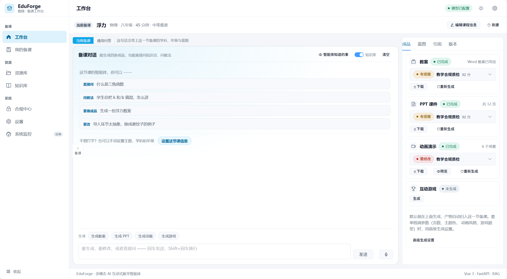
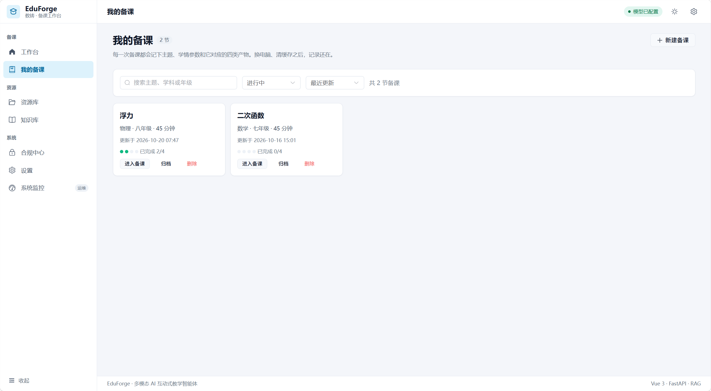
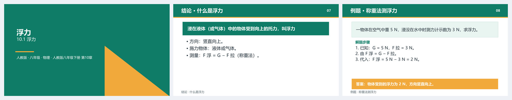
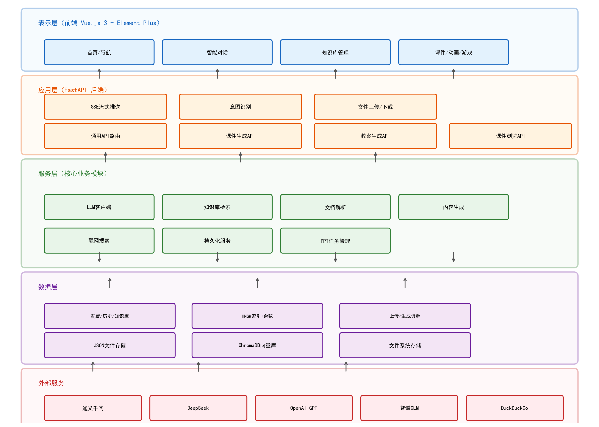
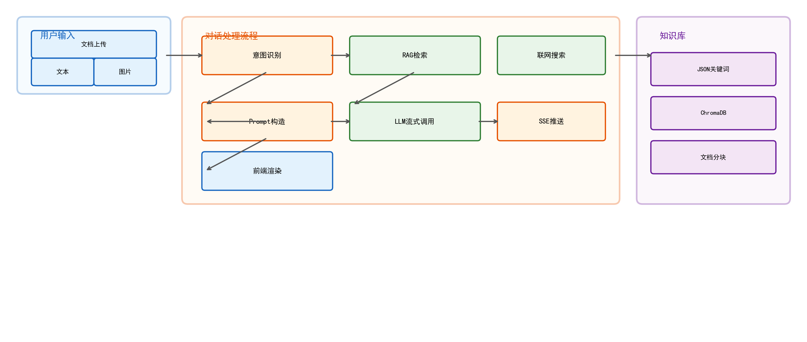
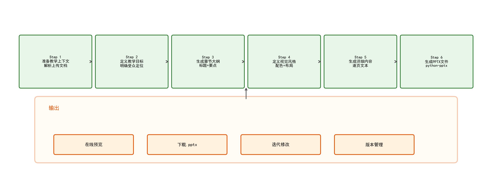

<div align="center">

# EduForge · 教铸

### 面向 K-12 教师的本地化多模态备课智能体工作台

*Local-first multimodal lesson-preparation agent workbench for K-12 teachers*

[](https://fastapi.tiangolo.com)
[](AGENTS.md)
[](LICENSE)

</div>

---

> **30 秒看懂**：描述一节课 → 拿到可编辑的教案 / PPT / 动画 / 游戏，
> 外加两道合规关卡。**本地优先**：默认不出校，模型失败会明确报告而不是假装生成。
>
> - 上手：[快速开始](#快速开始) · 不懂就先看 [功能状态（如实标注）](#功能状态如实标注)
> - 想看边界：[验收边界](#验收边界) · [数据合规](#数据合规)
> - 想看设计：[设计取舍](#设计取舍为什么是本地优先--可验证的教学约束)
> - 想看历程：[项目工程日志](docs/PROJECT-JOURNAL.md)

> **项目状态**（如实说明，避免误会）：
> 这是一个**个人毕业设计项目**，核心链路已跑通并通过 1180+ 项离线冒烟测试。
> 但仍有能力未完成 —— **PPT 动画**（python-pptx 无相关 API，做不到）、
> **AI 生图**（默认关闭，避免消耗使用者的额度）、**内容准确率**未经学科教师人工抽检。
> 这些都在 [验收边界](#验收边界) 中逐条列出，不隐藏、不夸大。
> 开源是希望获得真实反馈，欢迎提 Issue。

## 它解决什么问题

教师每周要花大量时间写教案、做课件、出题、设计互动环节。**EduForge 把这件事变成"描述需求 → 获取可编辑成品"**：

- 输入「高二物理《牛顿第一定律》，2 课时，面向基础薄弱班级」，
- 输出：可编辑的 `.pptx` 课件、`.docx` 教案、配套互动小游戏、知识点动画脚本。

---

## 界面预览

**备课工作台**：左边对话、右边成品。一节课的教案 / PPT / 动画 / 游戏都在同一屏，
生成状态与合规分直接标在产物卡片上。



**「我的备课」**：每次备课记下主题、学情与对应的四类产物，刷新、换机后可恢复。



**产物效果**（由 EduForge 生成、未经人工排版调整的《浮力》课件）：
每页有明确的教学功能——封面 / 结论 / 例题，例题带完整解题步骤与答案。



> 更多细节见 [功能状态（如实标注）](#功能状态如实标注) 与 [验收边界](#验收边界)。

---

## 功能状态（如实标注）

> ✅ 可用 · 🚧 已具备基础能力、质量/覆盖待提升 · 📋 规划中

| 功能 | 状态 | 说明 |
|---|---|---|
| 教案生成（Word） | ✅ | 六阶段流水线，标准教案要素齐全，Word 导出质量较高 |
| PPT 课件生成 | ✅ | LLM 真实生成 + python-pptx 排版，已实测产出 10 页 / 45 分钟完整课件 |
| 互动游戏生成 | 🚧 | 产出自包含可玩 HTML（计时/计分/解析），题型覆盖仍在扩展 |
| 教学动画 | ✅ | 分层学科引擎 + LLM 知识点抽取，已实测产出可播放 HTML5 动画与准确知识点 |
| **出厂质检闸门** | ✅ | 每次生成后自动做教学合规扫描，结果随响应返回并在前端结果页标红（见 §教学合规质检） |
| 知识库 RAG | ✅ | 本地 bge-small-zh embedding + BM25/向量混合检索 + **本地 rerank** + 拒答 + 引用溯源 + 100 条评测集 |
| 多模态输入 | 🚧 | 图片/文件上传已支持，视觉理解接入内网多模态模型进行中 |
| 多 Agent 协作 | 🚧 | Agent 循环（规划/工具/失败恢复/结果验证）已落地，Critic 审查回路见路线图 |
| 模型调用 Harness | ✅ | 重试 / 超时 / 熔断 / 全链路追踪 / **降级显式标记**（已落地） |
| 敏感数据分级与出校管控 | ✅ | 本地定级（对齐 JY/T 0661-2025 L1–L5）+ 内网/公网路由判定 + 四种策略（off/warn/sanitize/enforce）+ 全链路插桩 + 响应头 `X-Data-*` 可追溯 + 顶栏流向徽标（见 §数据合规） |

**检索质量**（100 条自建评测集实测，`make eval` 可复现）：

| | 本地重排 | 不重排（降级） |
|---|---|---|
| Recall@1 | **0.967** | 0.944 |
| MRR@5 | **0.972** | 0.944 |
| 漏拒率（该拒却放行 → 会编造） | **0.000** | 0.100 |
| 延迟 p50 | 672ms | 13ms |

完整指标、阈值标定过程与已知缺陷见 [`docs/RAG.md`](docs/RAG.md#3-评测结果)。

**设计底线**：任何模型调用失败都如实暴露，绝不静默返回编造内容（旧版 demo 静默兜底已在重构中移除）。

---

## 架构



```
┌──────────────────────────────────────────────────────────┐
│                       前端 (Vue 3)                          │
│   备课工作台 · 对话 · 知识库 · 设置（可切换真实/演示模式）     │
└───────────────────────────┬──────────────────────────────┘
                            │  /api
┌───────────────────────────▼──────────────────────────────┐
│                  后端 (FastAPI)                            │
│  ┌────────────┐  ┌─────────────────────────────────────┐  │
│  │ LLM Harness│  │ 生成管线：PPT / 教案 / 动画 / 游戏     │  │
│  │ 重试·熔断  │  │  (Critic 审查回路设计中)               │  │
│  │ 追踪·降级  │  └─────────────────────────────────────┘  │
│  └─────┬──────┘  ┌─────────────────────────────────────┐  │
│        │         │ RAG：bge-zh embedding + 混合检索      │  │
│        └────────▶│ + 引用溯源 + 拒答阈值（重构中）        │  │
│  Provider: OpenAI / DashScope / DeepSeek / Local(vLLM)   │
└──────────────────────────────────────────────────────────┘
        本地优先：Ollama / vLLM / 内网 qwen3-vl-8b
```

**Harness 层**（企业级 LLM 调用）已落地，核心原则：

- 统一 `BaseLLMClient` 接口，所有 Provider 行为一致；
- 横切能力：重试（指数退避）、超时、熔断器、全链路追踪；
- **降级必须显式标记**（`degraded=True`），前端据此提示"非真实生成"，禁止伪装。

详见 [`docs/ARCHITECTURE.md`](docs/ARCHITECTURE.md)。

---

<details>
<summary>展开：对话链路图 与 PPT 生成管线图</summary>





</details>

## 技术栈

- **后端**：Python 3.11 · FastAPI · uv（依赖与虚拟环境管理）· ChromaDB · python-pptx / python-docx
- **前端**：Vue 3 · Vite · Element Plus · Pinia
- **模型**：OpenAI 兼容 API / 阿里云百炼 / DeepSeek / 本地 Ollama·vLLM（含内网多模态模型）
- **部署**：Docker 单容器（前端静态页 + 后端 API 同源）

---

## 快速开始

### 方式一：本地开发（uv）

```bash
# 1. 后端
cd backend
uv sync                      # 安装依赖（自动创建 .venv）
uv run uvicorn app.main:app --host 0.0.0.0 --port 8005 --reload

# 2. 前端（另开终端）
cd frontend
npm install
npm run dev                  # http://localhost:5173
```

### 方式二：Docker（单容器，前后端同源）

```bash
cp .env.example .env        # 填入至少一个 API Key
docker compose up -d --build
# 访问 http://localhost:8005
```

> 关于这条路径的**如实说明**：
> - 镜像在**容器内部完成前端构建**（`frontend/dist` 不在版本控制里，
>   Dockerfile 会自己 `npm run build`），所以 clone 下来即可直接 build。
> - Dockerfile 与 compose 配置经静态核对，并由 [CI](.github/workflows/ci.yml)
>   在 GitHub 环境中真实构建 + 健康检查（作者本机无 Docker，不空口承诺）。
> - 若想最快看到界面，**推荐方式一**（本地 uv + npm，已实测 3 秒起后端）。

⚠️ 一个已知坑：容器内 `LOCAL_MODEL_URL` 默认填的是 `http://localhost:8001/v1`，
这个 `localhost` 指**容器自己**。要连宿主机上的本地模型，请改成
`http://host.docker.internal:8001/v1`。

---

## 配置大模型

在 Web 设置页选择 Provider 并填入 Key，或在 `.env` 中配置环境变量。
推荐使用**本地模型**以满足数据不出校的合规要求：

- Ollama：`LOCAL_MODEL_URL=http://localhost:11434/v1`
- vLLM / 内网 qwen3-vl-8b：暴露 OpenAI 格式端点即可直接接入

未配置模型时，系统会**明确提示**而非假装生成——这是与企业级玩具的分界线。

---

## 项目结构

```
backend/
  app/
    core/harness/        # 企业级 LLM 调用层（重试/熔断/追踪/降级）
    services/llm/        # 各 Provider 实现 + LLMService 单例
    services/llm/token_limit.py  # 输出上限统一解析（防长内容被截断）
    services/            # 生成管线（PPT/教案/动画/游戏）、RAG、对话
    services/teaching_compliance.py  # 教学合规规则引擎 + 出厂质检闸门
    api/                 # 路由（courseware / ppt / lesson_plan）
    api/teaching_compliance.py       # 独立质检接口 /teaching-compliance/check
    main.py              # 应用入口（含生产环境前端托管）
frontend/
  src/views/             # 备课工作台各页面
  src/api/               # 接口封装（含只读的数据流向拦截器）
  src/components/ComplianceReport.vue  # 质检报告展示（按 error/warn/info 分级标红）
scripts/                 # 冒烟测试与诊断脚本（均在项目根目录运行）
docs/                    # 架构 / 部署 / 设计文档
```

---

## 设计取舍：为什么是"本地优先 + 可验证的教学约束"

通用 AI 助手也能生成教案、PPT、动画、游戏，且模型能力更强。但教师最痛的几件事，
纯云端工具**结构性做不到**：

| 教师真实痛点 | 通用云端工具 | EduForge |
|---|---|---|
| 课件和本校教材版本对不上 | 不知道版本 | 教材版本坐标系（版本×册×单元×课时） |
| 不敢用 AI 内容，不知依据在哪 | 无出处 | 课标依据可追溯 |
| 上次月考的班级共性错题用不上 | 合规上不能上传 | 本地分析，数据不出校 |
| 换岗后教案找不到、教研成果无法传承 | 对话即焚 | 校本资源库 + 版本与复用 |

**合规是进校的许可证**：《中小学生成式人工智能使用指南（2025 年版）》明确
"严禁师生在使用生成式人工智能工具时输入考试试题、个人身份信息等敏感数据"。
这意味着学校需要的不是"更强的生成"，而是有人为"这份教案符合我校教材版本、
没有泄露学生隐私"**担责**的可验证约束 —— 教学合规质检（见下文）补的正是这个位置。

---

## 数据合规

**为什么值得单独一节**：这是我们对外讲"数据不出校"时的**证据**，而不是口号。
每次生成都做本地定级，并把结论写进响应头 —— 管理员打开 F12 就能验证。

```
输入文本 ──► classify()  本地正则定级 L1~L5（零网络依赖）
              │
              ├─► is_private_endpoint(base_url)  目标是否在校内？
              │
              └─► decide()  按 EDUFORGE_SAFETY_MODE 决策
                    ├─ off      原样发出
                    ├─ warn     原样发出 + 告警 + 响应头标注   ← 默认
                    ├─ sanitize 本地脱敏后发出（抹身份、留语义）
                    └─ enforce  达 L3 且目标在公网 → 阻断，不发出
```

**策略开关**：`EDUFORGE_SAFETY_MODE`（`off` / `warn` / `sanitize` / `enforce`，默认 `warn`）。

**每次响应都带出流向**，无需额外查询：

| 响应头 | 含义 |
|---|---|
| `X-Data-Level` | 本次数据定级 L1–L5 |
| `X-Data-Route` | `local`（校内）/ `cloud`（公网） |
| `X-Egress` | 是否离开校内网络 |
| `X-Data-Action` | `pass` / `warn` / `redact` / `block` |
| `X-Data-Findings` | 命中类型与数量（**只放类型，绝不放原文**） |

**生成前可预检**（前端在提交前调用，本地执行、不联网）：

```bash
curl -X POST localhost:8000/api/safety/scan \
  -H 'Content-Type: application/json' \
  -d '{"text":"本次月考成绩：张三 85 李四 92 王五 78","preview_redact":true}'
# → {"level":"L4","action":"warn","findings":[{"kind":"score_table",...}],
#    "redacted_text":"本次月考成绩：学生A 85 学生B 92 学生C 78"}
```

**两条诚实的边界**（都会在文档里持续标注，不掩饰）：

1. **整段试题无法脱敏后上云** —— 教学价值就在题面本身，抹掉题面等于抹掉全部用途。
   `sanitize` 模式遇到试题会**退化为阻断**，而不是给你"已经安全了"的假象。这类内容只能用本地模型。
2. **识别是正则 + 结构规则，不是模型**。用模型识别敏感信息有个致命悖论：
   **识别本身就要把原文送进模型**。若那个模型在云端，等于为了防泄漏先泄漏一次。
   代价是精度有限 —— 高置信规则（身份证/手机号/邮箱/考号）可直接用于阻断；
   结构规则（成绩表/名单/试题段）可能误报，因此默认只告警不阻断。

**调用链路插桩**：本项目历史上有 4 条独立的 LLM 调用路径，只在网关检查会让
教案/PPT/动画/游戏生成完全裸奔。已在 3 个收口点全部插桩，
`scripts/smoke_safety.py` 里有静态回归校验防止新增链路时漏掉。

**前端呈现**：顶栏常驻流向徽标 —— 绿色「校内 · 未出校」/ 琥珀「云端 · 已脱敏」/
红色「已拦截 · L4」，悬停展开完整信息并提示可在 Network 面板复核。
用只读拦截器实现（`frontend/src/api/dataFlow.js`），装在 4 个 axios 实例上，
绝不修改任何请求或响应。

验证：`make smoke-safety`（后端 70 项断言，含"古诗不应误报""掌握率不应被当成学生名"等反例）。

---

## 教学合规质检

数据合规管的是「**数据出不出去**」，教学合规管的是「**内容能不能上讲台**」——
两道关相互独立，都要过。

通用 AI 工具只会"生成"，不会按中国课标把关。这个校验器是**纯规则、离线**的，
不调用大模型、零额度消耗，因此可以无成本地在每次生成后跑一遍。

```
生成完成 ──► run_compliance_gate()  纯规则离线扫描（零网络依赖）
                  │
                  ├─ R1 课标依据      是否引用 2022 版课标
                  ├─ R2 核心素养升级  是否仍用旧"三维目标"措辞
                  ├─ R3 教材版本      是否标注版本 / 对应章节
                  ├─ R4 学段匹配      内容是否超出所选学段
                  ├─ R5 隐私泄露      手机号/身份证/姓名:成绩（error）、邮箱（warn）
                  ├─ R6 时长规范      页数 vs 课时承载
                  ├─ R7 行为动词可测量 教学目标是否用了"了解/理解/掌握"这类无法评价的词
                  └─ R8 教学评一致性   有教学目标却没有检测/评价设计，目标无法验证是否达成
                                       （R7/R8 均只在调用方给出结构化文本时检查，避免误报）
                  │
                  └─► 评分：100 起，error −25 / warn −8 / info 0
                      有 error 即 passed=false，随生成响应返回并在前端结果页标红
```

**设计底线 —— 只报告、不阻断**：闸门出任何异常都被吞掉并返回 `enabled=False`，
绝不因质检让生成结果丢失；前端只做提示，不影响下载与预览。

**独立调用**（不依赖生成流程，可用于 CI 或人工复核）：

```bash
curl -X POST localhost:8005/api/teaching-compliance/check \
  -H 'Content-Type: application/json' \
  -d '{"artifact_type":"lesson_plan","content":"联系 13812345678。成绩：张三：85。","meta":{"level":"小学"}}'
# → report.passed=false，issues 列出 R4(学段) / R5(隐私)，suggestions 给修改建议
```

**接入点**：教案 / PPT / 动画 / 游戏四个生成接口的响应都带 `compliance` 字段；
PPT 走后台任务，报告写在 `task.result.compliance`，随 `/api/ppt/status` 轮询带出。
开关：`EDUFORGE_COMPLIANCE_GATE=0` 可一键关闭。

**误报是有代价的，所以被认真对待**：物理题里「重力：10N」「答案：3」与
"姓名:成绩"长得一模一样，早期版本会把它们判成隐私泄露。现已加入
非人名标签黑名单 + 单位/百分号排除 + 词首锚定，并把这些反例写进测试。

验证：`scripts/smoke_teaching_compliance.py`（77 项，含误报反例）。

**实测一例**（真实生成的初中物理《浮力》教案）：目标整体写得具体（"能基于压力差示意图说明浮力产生的原因"），
但夹了"知道、认识"这类词 —— R7 精确挑出并给出替换清单，最终 92 分。
这正是它的价值：不是笼统打分，而是给出**能直接照着改**的具体建议。

---

## 验收边界

> 边界先讲清楚，免得拿教务系统的尺子来量它。

**它是什么**：一个给 K-12 教师用的**备课**工作台 —— 把一节课要用的教案、PPT、动画、游戏
在一次对话里迭代出来，过程中有两道自动质检（教学合规、数据出校），产物可回退。

**验收看三条**：

| 维度 | 具体判据 |
|---|---|
| 能跑 | 装好就能跑：无外部服务依赖，模型可换，断网也能生成（产物不依赖 CDN） |
| 可验证 | 生成完自动出质检报告（R1–R8），指出哪一条不合格、怎么改，而不只是打个分 |
| 可回退 | 每一次"按这句改"都留一版，回退不删历史，改坏了能再回退回来 |

**明确不做**（不是没做完，是刻意不进这个项目）：

- 班级/学生成绩档案、知识点掌握度长期画像 —— 属于教务域，且是高敏感数据
- 三角色审批流（教师/教研/学生）—— 会把系统边界撑爆
- 作业批改与考试系统 —— 与"备课"不是一个环节

**质量保证怎么自证**：988 项离线冒烟测试（不消耗模型额度、秒级跑完），
覆盖数据合规、教学合规、教案健壮性与 Word 排版、版本链、迭代修改、前后端接口路径契约、
对话意图路由与问答语境、从一句话读课程信息、预置知识库与教案排版、产物离线可用性。
另含 100 条 RAG 评测集（`make eval`）与预置知识库（21 篇约 5.4 万字，随仓库自带）。另有 100 条自建 RAG 评测集（`make eval` 可复现）。

---

## 路线图

1. ✅ **企业级 RAG**：本地 bge-zh embedding + 混合检索（BM25+向量）+ **本地 rerank** + 拒答闸门 + 引用溯源 + 100 条评测集。
2. ✅ **教学目标对齐 2022 版课标**：弃用三维目标，改为学科核心素养维度 + 课标依据（渲染器维度无关，兼容历史输出）。
2.5 ✅ **合规自证**：输入数据分级（对齐 JY/T 0661-2025）+ 内网/公网路由判定 + 四种策略模式 + 全链路插桩 + 响应头可追溯 + 生成前预检接口 + 顶栏流向徽标。
3. ✅ **教学合规校验器 v1 已落地（R1~R8）**：课标依据 / 核心素养升级 / 教材版本 / 学段适配 / 隐私泄露 / 课时配平 / **行为动词可测量** / **教学评一致性** 八类规则化 linter，已接入全部四个生成接口作为「出厂质检闸门」，并在前端结果页实时展示。后续可扩展：目标-活动-检测条目级对应 / 学科专属规则 / 与课标原文比对 / 进 CI。
4. **教材版本坐标系**：版本×册×单元×课时作为一等公民字段，贯穿教案/课件。
5. **学情闭环**：导入考试/作业数据 → 班级共性薄弱点 → 自动进入"预设提问/当堂检测"。
6. **多 Agent 协作**：Planner / Researcher / Designer / Generator / **Critic** / Orchestrator，Critic 审查回路。
7. **真多模态**：接入内网 qwen3-vl-8b 实现图片理解、讲义 OCR、板书识别。
8. **MCP / Skill 扩展**：开放工具与技能插件机制，方便二次开发。
9. **知识点图谱**：从"文档检索"升级到"知识点检索"，支撑变式题与举一反三。

> 第 3 项（教学合规校验器）是本项目差异化最强的一条：
> 它依赖 2022 版课标条目、教材版本目录、学科核心素养清单 —— 中国特有且需人工整理的数据资产，
> 且本质是"验证"而非"生成"，大模型能力在这里帮不上忙。
>
> 第 5、9 项定位为「导入 + 组装 + 对齐」：不重复建设题库内容，
> 通过导入接口接入学校已有资源，EduForge 只做下游的组装、课标对齐与校本沉淀。

---

## 贡献

欢迎 Issue 与 PR。提交前请运行冒烟测试（均在项目根目录，不消耗模型额度）：

全部 988 项，均不消耗模型额度、秒级跑完（完整清单见 [`AGENTS.md`](AGENTS.md#提交前必须跑通的验证)）：

```bash
PYTHONPATH=backend uv run --project backend python scripts/smoke_safety.py
#   数据合规：70 项（分级 / 脱敏 / 阻断 / 调用链路插桩）

PYTHONPATH=backend uv run --project backend python scripts/smoke_teaching_compliance.py
#   教学合规：77 项（R1~R8 规则 / 隐私分级 / 误报反例 / 质检闸门）

PYTHONPATH=backend uv run --project backend python scripts/smoke_lesson_plan.py
#   教案健壮性：29 项（输出上限防截断 / 补全不丢内容 / 各 provider 统一上限）

PYTHONPATH=backend uv run --project backend python scripts/smoke_lesson_tasks.py        # 40 项：课程台账
PYTHONPATH=backend uv run --project backend python scripts/smoke_llm_service.py         # 14 项：模型降级不静默
PYTHONPATH=backend uv run --project backend python scripts/smoke_artifact_versions.py   # 53 项：成品版本链
PYTHONPATH=backend uv run --project backend python scripts/smoke_lesson_plan_revise.py  # 37 项：按指令迭代修改
PYTHONPATH=backend uv run --project backend python scripts/smoke_api_contract.py        # 13 项：前后端接口路径契约
PYTHONPATH=backend uv run --project backend python scripts/smoke_offline_artifact.py    # 27 项：离线可用性（漏报/误报双向）
PYTHONPATH=backend uv run --project backend python scripts/smoke_teaching_review.py     # 27 项：模型深度复查（默认关闭也要能跑通）
PYTHONPATH=backend uv run --project backend python scripts/smoke_lesson_tutor.py        # 49 项：问答的课程语境与行为准则
PYTHONPATH=backend uv run --project backend python scripts/smoke_lesson_docx.py         # 35 项：教案 Word 排版（A4/字号/真列表/字面量自愈）
PYTHONPATH=backend uv run --project backend python scripts/smoke_knowledge_base.py      # 56 项：预置知识库（规模/结构/元数据/评测集对齐）
PYTHONPATH=backend uv run --project backend python scripts/smoke_rag_seed_sync.py    # 31 项：种子索引增量同步与来源标记
PYTHONPATH=backend uv run --project backend python scripts/smoke_course_knowledge.py  # 41 项：四路生成共用同一份课程知识
PYTHONPATH=backend uv run --project backend python scripts/smoke_teaching_workflow.py   # 209 项：教学意图/蓝图/工作流与接口兼容

node scripts/smoke_chat_action.mjs       # 45 项：一句话判 改/生成/提问
node scripts/smoke_dialogue_fields.mjs   # 25 项：缺字段中文映射（译不出不编造）
node scripts/smoke_lesson_intent.mjs     # 47 项：从一句话里读出主题/学科/年级
node scripts/smoke_speech.mjs            # 21 项：语音错误码翻译 / 朗读前文本清洗
node scripts/smoke_markdown_code.mjs     # 23 项：代码块高亮真的接进了 marked

cd backend && uv run python tests/test_harness.py   # Harness 离线自测
```

排查「生成成功但内容为空」这类症状用（会真实调模型，约 2 分钟）：

```bash
PYTHONPATH=backend uv run --project backend python scripts/diag_lesson_plan_stage3.py
#   打印 finish_reason：stop=正常，length=输出被截断
```

---

## 许可证

[Apache License 2.0](LICENSE)
